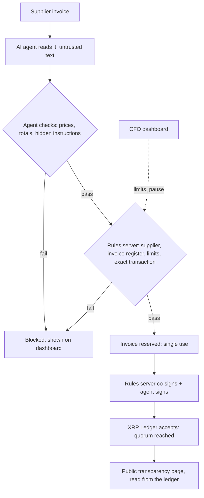

# Imali Yethu: Corruption-Proof Public Payments

> *"Imali Yethu" means "Our Money".*
> An AI agent that pays government suppliers only by rules nobody can secretly bend, with every rand public on the XRP Ledger.

**Team:** PhephaSec · **Hackathon:** Node Engine Hackathon · **Track:** Agentic Finance (Ripple)

---

## The problem

South African municipalities carry a national balance of **R268 billion** in unauthorised, irregular, fruitless and wasteful expenditure (UIFWE), up from R264 billion the year before ([National Treasury MFMA compliance report 2024/25](https://www.gov.za/news/media-statements/national-treasury-releases-municipal-finance-management-act-compliance-report), pre-audit figures). Treasury links it to failures in internal controls and weak consequence management. Much of it is lost at the **payment stage**: inflated invoices, paying the same invoice twice, payments to the wrong account, and spending nobody outside the municipality can see.

## What works today

| Capability | Status | Where |
| --- | --- | --- |
| AI invoice reading (Claude), invoice text treated as untrusted | ✅ Working | `agent/invoice_reader.py` |
| Price check against market prices (>20% above is blocked), plain code, no AI | ✅ Working | `agent/price_check.py` |
| Hidden-instruction (prompt injection) detection | ✅ Working | `agent/invoice_reader.py` |
| Supplier wallet taken from the register, never from the invoice | ✅ Working | `data/suppliers.json` |
| Independent rules server: approved suppliers, invoice register, per-payment limit, weekly cap, single-use invoices | ✅ Working | `rules_server/` |
| Rules server checks the **exact** transaction (wallet, amount, memo, fee, flags) before signing | ✅ Working | `rules_server/xrpl_verification.py` |
| **XRPL multisig**: rules server co-signs only after every check passes | ✅ Built and tested · activate on Testnet with `scripts/setup_multisig.py` | `POST /cosign`, `agent/xrpl_payments.py` |
| CFO limits and kill switch, held by the rules server (agent cannot reach them) | ✅ Working | `GET/PUT /policy`, `POST /pause` |
| Dashboard: submit invoices, decision trail, payments register, controls, staff sign-in | ✅ Working | `dashboards/app.py` |
| Public transparency page read **live from the XRP Ledger** | ✅ Working | `dashboards/app.py` |
| Real XRPL Testnet payments with invoice memo | ✅ Working | see Testnet proof |
| Escrow: "no delivery, no payment" | 🔜 Roadmap | |
| Connected-supplier and contract-splitting checks | 🔜 Roadmap | |
| Live supplier data from the Central Supplier Database (CSD) and CIPC | 🔜 Roadmap | |

## How a payment flows



## Security model

The Treasury account is controlled by an XRPL signer list with **quorum 3**:

| Signer | Weight | Who holds the key |
| --- | --- | --- |
| AI agent | 1 | The agent service |
| Rules server | 2 | The independent rules server only (the agent never sees this key) |
| Municipal CFO | 1 | Human, for emergencies |
| Municipal Manager | 1 | Human, for emergencies |

| Who signs | Total | Can move money? |
| --- | --- | --- |
| Agent alone | 1 | No |
| Rules server alone | 2 | No |
| **Agent + rules server** (normal path) | 3 | Yes, only if every rule passes |
| Agent + CFO + Municipal Manager (emergency) | 3 | Yes, two humans must agree |

With the master key disabled (`setup_multisig.py --disable-master`), **the ledger itself** rejects any payment the rules server did not sign. A hacked agent can propose a payment to a fake wallet, but it cannot complete it.

**Rules server safeguards** (all covered by tests):

- Signs only invoices that are registered, approved and reserved, and only once (`reserved → signed` is a single atomic update).
- Checks the whole autofilled transaction: destination is the registered supplier's wallet, amount matches the invoice, one invoice memo, no partial-payment flags, fee under a cap, and the transaction expires.
- Refuses everything while the CFO's kill switch is on, even if the agent ignores its own pause flag.
- CFO limits need a separate admin key. If that key is missing, or equals the agent's key, the server fails closed.
- Every policy change is written to an audit log with old and new values.

**Signing modes** (`SIGNING_MODE` in `.env`): `multisig` (target design), `privy` (agent's policy-limited Privy wallet), `master` (demo fallback: the Treasury seed signs alone, so only the agent-side checks and the rules server's approval apply). The dashboard's *Controls & limits* page reads the Treasury's real signer list from the ledger and says which applies.

**Privacy (POPIA):** directors' details stay off-chain. Only the invoice number and amount go on the public ledger, and blocked invoices are published as totals only.

## Quick start

```bash
python -m venv .venv
.venv\Scripts\Activate.ps1          # macOS/Linux: source .venv/bin/activate
python -m pip install -r requirements.txt
cp .env.example .env                # then fill in ANTHROPIC_API_KEY and the keys below

python scripts/setup_wallets.py                 # funded Testnet wallets -> .env
python scripts/setup_governance_wallets.py      # CFO and Municipal Manager wallets -> .env
python scripts/setup_multisig.py                # shows the signer-list plan; add --apply to submit

uvicorn rules_server.main:app --port 8000 --reload   # terminal 1
streamlit run dashboards/app.py                      # terminal 2
```

Sign in to the dashboard with `DASHBOARD_CFO_PASSWORD` or `DASHBOARD_FINANCE_PASSWORD` from `.env`. The public transparency page needs no login.

`.env` holds wallet seeds and keys and is git-ignored. Never commit it.

## Demo script

Before presenting, clear local state so every scenario runs fresh: `python scripts/reset_demo.py --yes`, then restart the rules server.

In the dashboard, open **Submit invoice** and use the samples:

| # | Invoice | What happens |
| --- | --- | --- |
| 1 | Laptop, correct price | Approved, co-signed, paid on Testnet. Link to the ledger. |
| 2 | Office chairs (second supplier) | Approved and paid: any registered invoice works. |
| 3 | Laptop at an inflated price | Blocked by the agent: 233% above market price. |
| 4 | Invoice with hidden instructions | Blocked by the agent: instructions aimed at the payment system. |
| 5 | Same, with **Demo: simulate a hacked agent** | The agent is fooled and tries to pay a fake wallet. The rules server refuses to co-sign. No money moves. |
| 6 | Laptop again | Blocked: invoice already paid. |
| 7 | CFO pauses payments, then any invoice | Blocked by the rules server: payments paused. |

Then open **Public transparency**: the payments are read straight from the XRP Ledger.

## Deployment

- **Dashboard:** Streamlit Community Cloud, main file `dashboards/app.py`. Put the `.env` values in the app's *Secrets*.
- **Rules server:** `render.yaml` is a Render blueprint (`uvicorn rules_server.main:app`). Set the secret values in Render.
- **CI:** `.github/workflows/tests.yml` runs the test suite on every push. Tests need no secrets or network: Claude is mocked and XRPL keys are generated offline.

## Business model and go-to-market

**Who buys first.** Donor-funded programmes, NGOs and corporate social investment (CSI) funds that pay many small suppliers and must prove where the money went. They can adopt new tools in weeks. Municipalities follow through provincial or National Treasury pilots, starting with one municipality's maintenance and supplies budget.

**Pricing (proposed).** A monthly platform fee per organisation, tiered by annual spend through the system, plus a small fee per payment for donor programmes. The value case is simple: one blocked inflated invoice (R35,000 in the demo) can pay for a year's subscription.

**Market.** South Africa has 257 municipalities and each must report irregular expenditure every year. The controls are country-neutral; only the data sources (supplier register, officials list, price list) change, so the same product fits public bodies and donor programmes across Africa.

**Fit with local infrastructure.**

| Need | Plan |
| --- | --- |
| Pay in rand | XRPL as the control and audit layer; settle through a regulated rand stablecoin or RLUSD with a local off-ramp or bank partner |
| Supplier registration and tax compliance | Check suppliers against National Treasury's Central Supplier Database (CSD) |
| Connected suppliers | Match company directors (CIPC records) against officials and their relatives |
| Municipal reporting | Export payment records for mSCOA reporting and the Auditor-General |
| Regulation | Designed around MFMA supply chain management rules, POPIA, and SARB guidance on crypto assets |

## What it can't stop (yet)

Rigged tender decisions before the payment stage, cash bribes, and false ownership disclosures by suppliers. Next steps: escrow until delivery is confirmed, links to tender award records, and supplier ownership data.

## Testnet proof

| Step | Transaction |
| --- | --- |
| First payment (Treasury → Honest Supplier, 10 XRP, memo INV-2026-0001) | [7E5179…AEC57](https://testnet.xrpl.org/transactions/7E5179129DA1FB6847C7ADA11A49E3EEB65691EDE8F2D56CE5F56B68242AEC57) |

## Repository structure

```
imali-yethu/
├── agent/          # AI invoice reader, price checks, XRPL signing (multisig / Privy / master)
├── rules_server/   # FastAPI: policy, invoice register, verification, co-signing
├── dashboards/     # Streamlit dashboard (app.py) and its theme and data helpers
├── data/           # sample suppliers, invoice register, prices, sample invoices
├── scripts/        # wallet, multisig and demo-reset scripts
└── tests/          # 96 tests: agent, rules server, co-signing, dashboard
```

## Team

| Name | Role |
| --- | --- |
| Melusi | AI agent, XRPL payments, dashboard |
| Nelisiwe | Security: rules server, multisig |

*All supplier, invoice, official and price data in this repo is sample data.*
