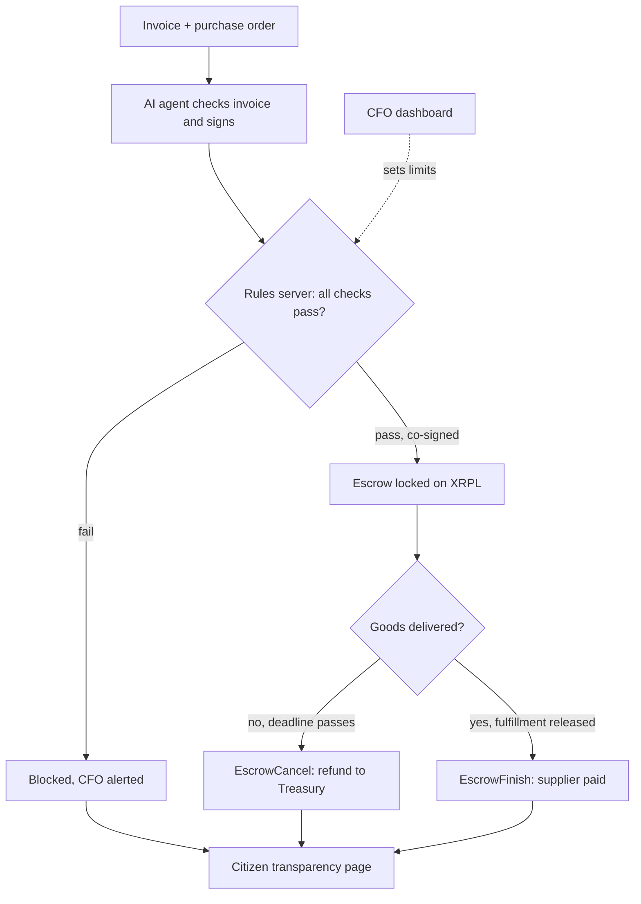

# Imali Yethu: Corruption-Proof Public Payments

> *"Imali Yethu" means "Our Money".*
> An AI agent that pays government suppliers only by rules nobody can secretly bend, for goods that actually arrive, with every rand public on the XRP Ledger.

**Team:** PhephaSec · **Hackathon:** Node Engine Hackathon · **Track:** Agentic Finance (Ripple)

---

## The problem

South Africa's Auditor-General reports large amounts of irregular and wasteful spending by municipalities and government departments every year. Much of it is lost at the **payment stage**:

| Corruption trick | How Imali Yethu stops it |
| --- | --- |
| Inflated prices (R50,000 for laptops worth R15,000) | The agent compares invoices with market prices and blocks them |
| Ghost deliveries (paid, nothing arrives) | Money is locked in XRPL Escrow and released only on proof of delivery |
| Connected suppliers (a company linked to an official) | Supplier directors are checked against a list of officials and relatives |
| Contract splitting (small invoices to dodge tender rules) | Repeated payments just under the threshold are detected |
| Duplicate invoices | Invoice numbers are recorded and checked |
| Hidden spending | Every payment is on a public ledger, with a citizen dashboard |
| A corrupt official or hacked AI | Multisig: no single person, and not even the agent, can move money alone |

## Target users

- **Primary:** municipal CFOs and finance teams in South Africa who need clean audits. Pilot: one Free State municipality's maintenance and supplies budget.
- **Secondary:** NGOs and corporate CSI funders managing public or donor money.
- **Beneficiaries:** citizens, who can see where every rand goes.

## Core features

1. **AI invoice checker:** reads invoices, compares prices with market rates, approves or blocks with a plain-language reason.
2. **No delivery, no payment:** approved payments are locked in XRPL Escrow and released only when delivery is confirmed (QR code or photo). No delivery means the money returns automatically.
3. **Rules the agent can't override:** an independent rules server co-signs payments through XRPL multisig.
4. **Human-controlled limits:** a CFO dashboard sets spending caps, approved suppliers and price ranges, outside the agent.
5. **Public transparency page:** every payment, linked to the XRP Ledger.

## How it fits the Agentic Finance track

| Requirement | How Imali Yethu meets it |
| --- | --- |
| At least one XRPL Testnet transaction executed autonomously by an agent | The AI agent creates escrow payments to approved suppliers |
| Limits enforced somewhere the agent doesn't control | Treasury multisig: every payment needs the agent **and** the independent rules server |
| A human operator can set or change limits, outside the agent | CFO dashboard (CFO key also on the signer list) |

## Architecture



**Treasury signer list (quorum 2):** Agent (weight 1) · Rules server (weight 1) · Municipal CFO (weight 2). Master key disabled.

## Repository structure

```
imali-yethu/
├── agent/          # AI invoice checker + XRPL transactions
├── rules_server/   # FastAPI co-signer + corruption checks
├── dashboards/     # Streamlit: CFO, delivery, citizen pages
├── data/           # sample suppliers, officials, price list
├── scripts/        # wallet setup and Testnet test scripts
└── docs/           # diagrams and notes
```

## Getting started

```bash
git clone <this repo>
cd imali-yethu
python -m venv .venv && source .venv/bin/activate   # Windows: .venv\Scripts\activate
pip install -r requirements.txt

python scripts/setup_wallets.py   # creates 5 funded Testnet wallets, saves them to .env
python scripts/first_payment.py   # first payment on XRPL Testnet, prints the explorer link
```

`.env` holds wallet seeds and is git-ignored. Never commit it.

## Testnet proof

| Step | Transaction |
| --- | --- |
| First payment (Treasury → Honest Supplier, invoice memo) | *add explorer link here* |

## Build plan

| Day | Build |
| --- | --- |
| Mon 9 Nov | Repo, Testnet wallets, first payment |
| Tue 10 Nov | Milestone forms; RLUSD trust lines; Escrow create / finish / cancel |
| Wed 11 Nov | Treasury multisig; sample data; rules server |
| Thu 12 Nov | AI agent; delivery confirmation; dashboards |
| Fri 13 Nov | Demo scenarios end to end; demo video; final submission |

## Demo scenarios

1. Honest supplier: approved, escrowed, delivered, paid
2. Inflated tender: blocked with reason
3. Ghost delivery: escrow expires, money returns to Treasury
4. Connected supplier: blocked
5. Contract splitting: flagged
6. **Hacked agent:** a hidden instruction in an invoice makes the agent try to pay a fake supplier, and the ledger refuses because the rules server won't co-sign

## What it can't stop (yet)

Rigged tender decisions before the payment stage, and cash bribes. Next steps: link to tender award records and supplier ownership data.

## Team

| Name | Role |
| --- | --- |
| Melusi | AI agent, XRPL payments and escrow |
| Nelisiwe | Security: multisig, rules server, dashboards |

*All supplier, official and price data in this repo is sample data.*
