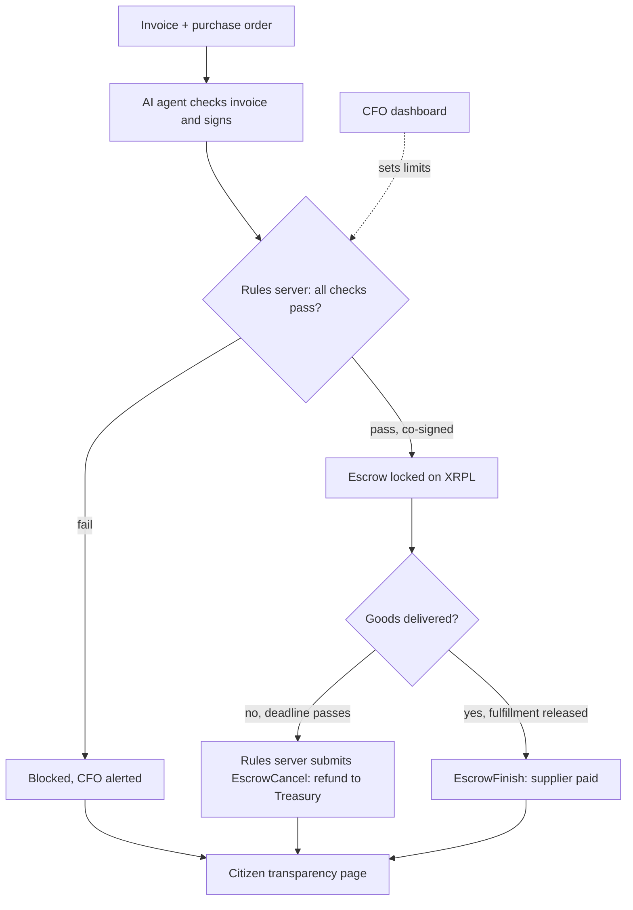

# Imali Yethu: Corruption-Proof Public Payments

> *"Imali Yethu" means "Our Money".*
> An AI agent that pays government suppliers only by rules nobody can secretly bend, for goods that actually arrive, with every rand public on the XRP Ledger.

**Team:** PhephaSec · **Hackathon:** Node Engine Hackathon · **Track:** Agentic Finance (Ripple)

---

## The problem

South African municipalities carry a national balance of **R268 billion** in unauthorised, irregular, fruitless and wasteful expenditure (UIFWE), up from R264 billion the year before ([National Treasury MFMA compliance report 2024/25](https://www.gov.za/news/media-statements/national-treasury-releases-municipal-finance-management-act-compliance-report), pre-audit figures). Treasury links it to failures in internal controls and weak consequence management. Much of it is lost at the **payment stage**:

| Corruption trick | How Imali Yethu stops it |
| --- | --- |
| Inflated prices (R50,000 for laptops worth R15,000) | The agent compares invoices with market prices and blocks them |
| Ghost deliveries (paid, nothing arrives) | Money is locked in XRPL Escrow and released only on proof of delivery |
| Connected suppliers (a company linked to an official) | Supplier directors are checked against a list of officials and relatives |
| Contract splitting (small invoices to dodge tender rules) | Repeated payments just under the threshold are detected |
| Duplicate invoices | Invoice numbers are recorded and checked |
| Hidden spending | Every payment is on a public ledger, with a citizen dashboard |
| A corrupt official or hacked AI | Multisig: no single person, no single key and not even the agent can move money alone |

## Target users

- **Primary:** municipal CFOs and finance teams in South Africa who need clean audits. Pilot: one Free State municipality's maintenance and supplies budget.
- **Secondary:** NGOs and corporate CSI funders managing public or donor money.
- **Beneficiaries:** citizens, who can see where every rand goes.
- **Beyond South Africa:** the same payment-stage fraud affects public bodies and donor-funded programmes across Africa. Only the data sources (supplier register, officials list, price list) are country-specific; the payment controls are not.

## Core features

1. **AI invoice checker:** reads invoices, compares prices with market rates, approves or blocks with a plain-language reason.
2. **No delivery, no payment:** approved payments are locked in XRPL Escrow and released only when the receiving official confirms delivery against the purchase order (photo as supporting evidence). If the deadline passes without delivery, the rules server cancels the escrow and the money returns to Treasury.
3. **Rules the agent can't override:** an independent rules server co-signs payments through XRPL multisig.
4. **Human-controlled limits:** a CFO dashboard sets spending caps, approved suppliers and price ranges, outside the agent.
5. **Public transparency page:** every payment, linked to the XRP Ledger.

## How it fits the Agentic Finance track

| Requirement | How Imali Yethu meets it |
| --- | --- |
| At least one XRPL Testnet transaction executed autonomously by an agent | The AI agent creates escrow payments to approved suppliers |
| Limits enforced somewhere the agent doesn't control | Treasury multisig: every payment needs the agent **and** the independent rules server |
| A human operator can set or change limits, outside the agent | CFO dashboard edits the caps, approved suppliers and price ranges stored in the rules server. The agent has no access to them |

## Architecture



## Security model

The municipal Treasury account has its **master key disabled** and is controlled by an XRPL signer list with **quorum 3**:

| Signer | Weight | Who holds the key |
| --- | --- | --- |
| AI agent | 1 | The agent service |
| Rules server | 2 | The independent rules server only (the agent never sees this key) |
| Municipal CFO | 1 | Human, for emergencies |
| Municipal Manager | 1 | Human, for emergencies |

| Who signs | Total | Can move money? |
| --- | --- | --- |
| Agent alone | 1 | No |
| Rules server alone | 2 | No |
| Any one human | 1 | No |
| Agent + one human | 2 | No |
| **Agent + rules server** (normal path) | 3 | Yes, only if every rule passes |
| Agent + CFO + Municipal Manager (emergency) | 3 | Yes, needs two humans to agree |

**Rules server safeguards**

- Checks the *whole* transaction before co-signing: destination, amount, invoice number and limits must match the approved invoice.
- Each approval is single-use, so it cannot be replayed for a different payment.
- Holds the escrow fulfillment secrets and releases one only after delivery is confirmed.
- Runs a scheduled job that submits `EscrowCancel` for escrows past their `CancelAfter` time. (On XRPL, `CancelAfter` only makes cancellation *possible*; someone has to submit it.)
- Policy changes from the CFO dashboard require login and are written to an audit log.

**Why the hacked-agent demo matters:** invoice text is untrusted input. Even if a hidden instruction fools the AI into proposing a payment to a fake supplier, the rules server refuses to co-sign, and the ledger rejects the transaction. The limits live somewhere the agent cannot reach.

**Privacy (POPIA):** directors' details and the officials list stay off-chain in the rules server. Only the invoice number and amount go on the public ledger.

## Repository structure

```
imali-yethu/
├── agent/          # AI invoice checker + XRPL transactions
├── rules_server/   # FastAPI co-signer + corruption checks
├── dashboards/     # Streamlit: CFO, delivery, citizen pages
├── data/           # sample suppliers, officials, price list
└── scripts/        # wallet setup and Testnet test scripts
```

## Getting started

```bash
git clone <this repo>
cd imali-yethu
python -m venv .venv
source .venv/bin/activate          # Windows PowerShell: .venv\Scripts\Activate.ps1
python -m pip install -r requirements.txt

python scripts/setup_wallets.py   # creates 5 funded Testnet wallets, saves them to .env
python scripts/first_payment.py   # first payment on XRPL Testnet, prints the explorer link
```

`.env` holds wallet seeds and is git-ignored. Never commit it.

## Project status

| Component | Status |
| --- | --- |
| Repo, structure, secrets handling | Done |
| Testnet wallets + first payment with invoice memo | Done (see Testnet proof) |
| Escrow create / finish / cancel | Next (10 Nov) |
| Treasury multisig (quorum 3) | Planned |
| Rules server | Planned |
| AI invoice agent | Planned |
| Dashboards (CFO, delivery, citizen) | Planned |

## Testnet proof

| Step | Transaction |
| --- | --- |
| First payment (Treasury → Honest Supplier, invoice memo) | *add explorer link here* |

## Build plan

| Day | Build |
| --- | --- |
| Mon 9 Nov | Repo, Testnet wallets, first payment |
| Tue 10 Nov | Checkpoint forms; RLUSD trust lines; escrow create / finish / cancel |
| Wed 11 Nov | Treasury multisig; sample data; rules server |
| Thu 12 Nov (Cape Town) | AI agent; delivery confirmation; dashboards |
| Fri 13 Nov (Cape Town) | Demo scenarios end to end; demo video; final submission by 23:59 |
| Sat 14 Nov | Pitch and judging |

## Demo scenarios

1. Honest supplier: approved, escrowed, delivered, paid
2. Inflated tender: blocked with reason
3. Ghost delivery: deadline passes, rules server cancels the escrow, money returns to Treasury
4. Connected supplier: blocked
5. Contract splitting: flagged
6. **Hacked agent:** a hidden instruction in an invoice makes the agent try to pay a fake supplier; the rules server won't co-sign, so the ledger rejects it

## What it can't stop (yet)

Rigged tender decisions before the payment stage, cash bribes, and false ownership disclosures by suppliers. Next steps: link to tender award records and supplier ownership data.

**Real-world settlement:** municipalities pay in rand. In production, XRPL acts as the control and audit layer, with settlement through a rand stablecoin or a bank partner. The first pilot is best run with an NGO or donor fund, which can adopt it faster.

## Team

| Name | Role |
| --- | --- |
| Melusi | AI agent, XRPL payments and escrow |
| Nelisiwe | Security: multisig, rules server, dashboards |

*All supplier, official and price data in this repo is sample data.*
